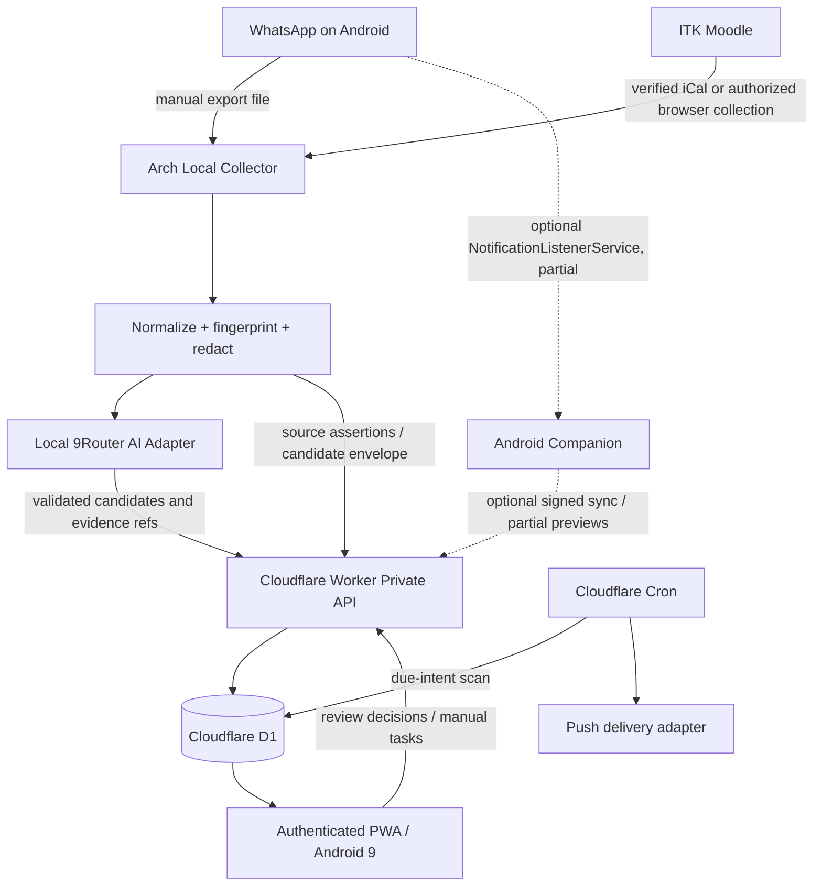

# 01 — SYSTEM ARCHITECTURE

## 1. Design tenets
**Cloud stores memory; local devices acquire intelligence.** The laptop is not an always-on server. A collector can disappear without breaking the task database, calendar, or cloud reminder checks. Use one small cloud Worker and one D1 database, not container orchestration.

Other tenets: explicit trust boundaries; provider neutrality; minimal cloud personal data; state reconciliation with stable idempotency; separate *freshness* from *availability*; no assumption that all notification previews equal all messages.

## 2. Logical components

**Deployment:** `workers.dev` endpoint or configured domain (if free). Worker serves static PWA assets and `/api/*`, with the app/protected routes behind a verified single-user identity layer. Scheduled handler processes reminder claims. D1 stores derived structured records, not raw chat exports. Arch runs `collector` and existing 9Router bound locally; optional Android app is a later stage.

## 3. Trust boundaries
1. **WhatsApp and ITK:** external, untrusted content; never execute strings or instructions from their pages/messages. No privileged university access.
2. **Arch local collector:** user-controlled but potentially stores sensitive exports, browser session and router token. Encrypted disk or protected app-specific directories; no routine sharing with cloud.
3. **AI provider:** the existing 9Router might forward requests beyond the laptop; show opt-in disclosure, redact irrelevant group-member data, keep bounded context, disable sensitive payload logging.
4. **Cloudflare Worker/D1:** assume provider processes stored structured data. Always authenticated, validate every input, restrict collector to write-scoped routes; consider sensitive group details before upload.
5. **Android PWA:** potentially old browser, inconsistent background push. Cached data is private and needs a clear/logout action; browser dev tools and device lock remain relevant risks.

## 4. Operating modes

| Mode | Dashboard | Saved tasks | New LMS/chat collection | AI recap | Reminders |
|---|---|---|---|---|---|
| Laptop on + network | Cloud | Yes | As enabled | Local 9Router | Cloud |
| Laptop off + network | Cloud | Yes | Only independent cloud feeds/optional phone listener | No local processing | Cloud |
| Phone offline | Local cached view | Last snapshot | No cloud sync | No | In-app snapshot only; no cloud delivery assurance |
| Cloud quota exhausted | Cached view/limited static assets | May be temporarily unavailable live | Local queue | Local if running | May pause; expose failure |
| 9Router offline | Cloud | Yes | Collect/no-AI preprocessing | Queued | Cloud |

## 5. End-to-end data flows
### 5.1 WhatsApp export
Owner exports allowed group on phone → transfers text file to Arch → local parser previews group/date coverage → local allowlist and consent gate → normalized messages and fingerprints → redacted context to 9Router with source IDs → JSON schema validation → `candidate` records, claim/evidence refs and minimal approved text sync through signed collector endpoint → owner reviews → canonical task update → cron reminder intent.

**Cloud data-minimization default:** store task title, action, course/group, due claims, minimal evidence excerpts and local opaque refs; not full message bodies, phone numbers, or message archives. User can turn off excerpt upload altogether, reducing review convenience; indicate evidence available only on laptop.

### 5.2 Moodle
Try **authorized iCalendar export** or existing student-visible APIs first. If unavailable, browser-assisted read of owner-visible course pages, without bypass, during signed-in sessions; or manual entry. Normalize Moodle source IDs/links when safe, attach semester/course and timestamp. Extract assignment due claims separately from chat dates. A password or tokenized URL never enters browser client/cloud unless a deliberate, separately reviewed trusted cloud integration is selected.

### 5.3 Review and scheduling
New claim creates `candidate_task` or `source_assertion`; duplicates can update evidence linkage. Only a user-authorized confirm/update may change canonical deadlines when sources disagree. Scheduler creates intents using date precision and owner's timezone preferences. Cloud cron leases eligible intent → dispatch adapter → record status; no assertion of actual physical-device delivery unless acknowledged by supported transport.

## 6. Source freshness model
- `last_observed_at`: time message/page was observed.
- `last_imported_at`: when ingestion recorded an item.
- `last_successful_sync_at`: successful connector run.
- `coverage_start/end`: *observed* interval, not proof of full capture.
- `coverage_quality`: `complete_export`, `partial_notification`, `calendar_window`, `manual`, `unknown`.
- `status`: `healthy`, `stale`, `partial`, `blocked`, `offline`, `not_configured`.
- `last_error_code` with sanitized detail.

Never label a notification feed `complete`. No recent data can mean either silence or missing messages; UI shows uncertainty.

## 7. Dependency decisions
- **Frontend:** Vite + TypeScript and lightweight UI layer (React or Svelte; choose once in ADR). Avoid unnecessary SSR; static assets reduce Worker invocations.
- **API:** TypeScript Worker + parameterized D1 SQLite; Zod/JSON Schema validation, capped payload size, explicit pagination.
- **Collector:** Python 3.11+ with parsers, optional Playwright browser adapter and local 9Router OpenAI-compatible client. systemd user timers/oneshot, no heavy daemon needed.
- **Cloud deployment:** Wrangler migrations and Secrets; dev and prod environments distinct.
- **Authentication:** Cloudflare Access (single authorized identity) is preferred *if deployment and free-tier fit are verified*. Collector ingestion uses separate service credential/endpoint controls. Fallback is a security-reviewed OAuth+allowlist session architecture, never an unauthenticated `workers.dev` API.
- **Offline:** service worker for static shell and IndexedDB read cache; manual edits in v0.1 offline are visibly disabled.
- **Push:** design adapter to support Web Push where feasible; runtime limits + VAPID implementation require spike. In-app reminder feed is always available.

## 8. Reliability patterns
- Idempotency: deterministic external fingerprints + server-side `(source_id, external_key)` uniqueness + request idempotency keys.
- Optimistic concurrency for user task edits: `version`/`If-Match`; on 409, fetch and reconcile.
- Local retries: bounded exponential backoff with jitter; never unbounded synchronous Worker work.
- Cron: atomic D1 conditional state transition `pending→leased→sent/failed/unknown`, expiry/retry with max attempts; duplicate send possible on ambiguous provider response, so track delivery semantics honestly.
- Dead-letter / failed sync: visible queue in UI and local logs with message contents redacted.
- Token hygiene: never forward 9Router API key, Moodle cookies or iCal tokenized URLs to the PWA.

## 9. Architectural acceptance criteria
- With Arch turned off, `/api/tasks`, `/api/reminders`, and app shell respond after owner authentication (subject to host availability).
- Importing same sample twice does not duplicate source events or candidate tasks.
- Unauthorized access, expired collector credentials and malformed envelopes are rejected before D1 writes.
- If 9Router returns non-JSON/injected instructions, no canonical task change occurs.
- A simulated Cloudflare API quota outage shows stale cached tasks with a clear warning; no fake successful sync.

See `02-DATA-MODEL.md`, `10-API-CONTRACTS.md`, `07-SECURITY-PRIVACY.md`.
