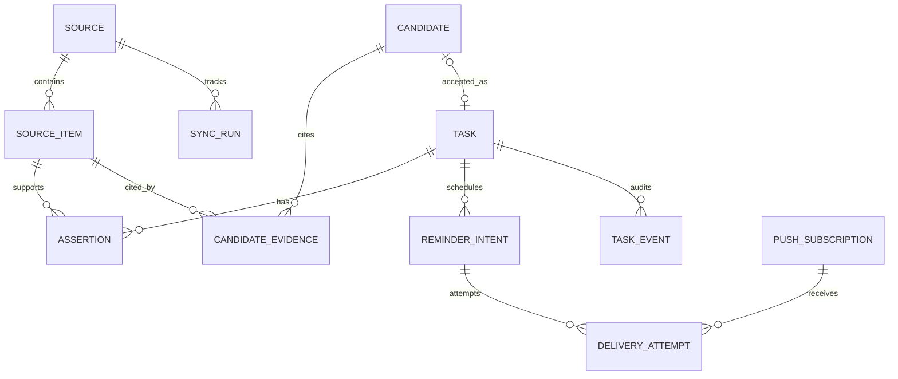

# 02 — DATA MODEL AND CANONICAL STATE

## 1. Storage choices
- **Cloud:** Cloudflare D1 (SQLite semantics). Store derived academic data, source metadata, review decisions and reminder intents.
- **Arch local:** encrypted-at-rest SQLite or files for raw authorized exports, normalized messages and import audit. Never sync raw chat history by default.
- **Android companion (optional):** app-private encrypted queue of notification previews, short retention, user-controlled wipe.
- **PWA:** IndexedDB snapshot of canonical tasks, group-safe recaps and source status; **not** long-lived tokens in localStorage.

## 2. Entity map

## 3. Core table contract
Implementation may adapt names, but maintain these semantics. All IDs are opaque UUIDs or ULIDs, not sequential IDs sent to clients. Timestamps in UTC ISO-8601 with timezone; explicitly store source timezone and `due_precision`.

| Table | Required fields and notes |
|---|---|
| `sources` | `id`, `kind` (`manual`, `moodle_ical`, `moodle_browser`, `whatsapp_export`, `whatsapp_notification`), `display_name`, `allowlisted`, `coverage_quality`, `status`, `last_successful_sync_at`, `created_at` |
| `sync_runs` | `id`, `source_id`, `started_at`, `finished_at`, `outcome`, `imported`, `deduped`, `parse_errors`, `coverage_start`, `coverage_end`, `sanitized_error` |
| `source_items` | `id`, `source_id`, `external_key`, `observed_at`, `content_hash`, `minimal_excerpt?`, `local_ref?`, `source_link?`, `privacy_class`, `created_at`, `deleted_at?`; unique `(source_id, external_key)` |
| `assertions` | `id`, `source_item_id`, `task_id?`, `field` (`due_at`, `title`, `instruction`, `status`, etc.), `typed_value_json`, `confidence_label`, `is_authoritative`, `created_at`, `revoked_at?` |
| `candidates` | `id`, `source_id`, `kind`, `suggested_title`, `suggested_due_local?`, `due_timezone?`, `due_precision`, `assignee_scope`, `rationale`, `review_status`, `validation_issues_json`, `created_at` |
| `candidate_evidence` | `candidate_id`, `source_item_id`, `quote_offset?`, `evidence_role`, PK `(candidate_id, source_item_id)` |
| `tasks` | `id`, `title`, `description?`, `status`, `priority`, `course?`, `due_at_utc?`, `due_local?`, `due_precision`, `timezone`, `manual_lock_fields_json`, `version`, `created_at`, `updated_at`, `archived_at?` |
| `task_events` | `id`, `task_id`, `actor_type` (`owner`,`system`), `event_type`, `before_json`, `after_json`, `evidence_ref?`, `timestamp` |
| `reminder_intents` | `id`, `task_id`, `rule_id`, `scheduled_for_utc`, `state`, `lease_until_utc?`, `attempt_count`, `dedupe_key`, `created_at`, `updated_at`; unique `dedupe_key` |
| `delivery_attempts` | `id`, `reminder_intent_id`, `subscription_id?`, `attempted_at`, `provider_response_class`, `state`, `error_code?` |
| `push_subscriptions` | `id`, `endpoint_ciphertext_or_protected`, `key_material_encrypted`, `device_name`, `created_at`, `revoked_at?`; treat endpoint as sensitive |
| `review_actions` | `id`, `candidate_id`, `action`, `user_override_json?`, `acted_at`, `result_task_id?` |
| `idempotency_keys` | `key_hash`, `request_scope`, `result_ref`, `created_at`, `expires_at` |
| `settings` | `owner_timezone`, `reminder_policy_json`, `retention_policy_json`, `last_briefing_at`, `schema_version` |

**Important:** if source metadata or task descriptions include private persons, encrypt at application layer where practical, or minimize those fields. Free-tier provider access is not end-to-end private.

## 4. Semantic rules
- **Date-only** assignments use `due_local = YYYY-MM-DD`, `due_precision=date_only`, `due_at_utc=null` until an explicit reminder policy converts them to a *notification instant*, never to an invented task deadline.
- **Exact datetime** stores both source-local representation and computed UTC instant, plus timezone origin. If timezone unknown, mark unresolved and require confirmation.
- **Unclear:** `due_precision=approximate` or `unknown`; never `1970-01-01`, `23:59`, or midnight placeholder.
- **Task status:** `todo`, `doing`, `done`, `blocked`, `archived`. Candidate review status is separate: `pending`, `accepted`, `dismissed`, `needs_clarification`.
- **Authority:** manually confirmed fields can be locked against automated replacement. A Moodle assertion may rank higher than chat for formal submission date, but a newer conflicting claim remains visible, not erased.
- **Priority:** separate urgency computed from time-to-due and owner-assigned importance. The AI can suggest, not determine final priority silently.

## 5. Dedup and conflict algorithm
1. Source-specific key: for Moodle, use stable event/assignment IDs when available plus course; for export lines, use normalized chat identity, sender label, timestamp, normalized body hash and occurrence index to handle identical repeats.
2. On overlapping import, compare the normalized payload and an import fingerprint; de-duplicate cautiously. If identity ambiguous, record an `ambiguous_duplicate` review item instead of dropping a potentially distinct message.
3. Extract candidate assertions with evidence. Link to an existing task only if course/source context and task identity are corroborated; never title-match alone.
4. A new due date differing from canonical creates a conflict. Preserve both assertions and source timestamps. Owner decision writes `task_event` and increments version.
5. On task completion/cancellation, pending reminders are recalculated or canceled in same logical transaction.

## 6. Invariants (testable)
- No candidate is accepted without a `review_action` and a linked task (manual task creation is a separate operation).
- Every assertion references an existing source item unless `manual_override` with a recorded owner action.
- Unique `(source_id, external_key)` and unique reminder `dedupe_key` remain enforced server-side.
- Task mutation requires optimistic version; conflict → HTTP 409, no lost edit.
- Deleting an import marks associated source items removed; tasks with independent sources survive. Orphan derived candidates are removed or labeled unsupported, according to retention policy.
- Read paths always filter `deleted_at IS NULL` and honor archive state unless explicitly requested.
- Snapshot exports represent coherent current state and include schema version.

## 7. Migration strategy
- Versioned SQL migrations tracked in repository and applied via Wrangler for D1.
- Forward migrations are additive where feasible; destructive changes require tested backup/restore path.
- Separate dev and prod bindings and migrations. No test fixture may contain real WhatsApp conversations.
- Index `tasks(due_at_utc,status)`, `tasks(updated_at)`, `reminder_intents(state,scheduled_for_utc)`, `source_items(source_id,external_key)`, `candidates(review_status,created_at)`, `sync_runs(source_id,started_at)`; inspect query plans against D1 row-read quotas.

## 8. Data-retention baseline (configurable)
- Raw export files: local only, retained until owner deletes; advise auto-delete after successful reconciliation, opt-in.
- Notification previews: default purge after 7 days on device once processed; no full history on cloud.
- Minimal evidence excerpts: retained only while associated tasks or review decisions need them; easy delete.
- Sync and error logs: 30-day sanitized rolling retention.
- Task audit/events: retain until explicit user deletion/export.

See `07-SECURITY-PRIVACY.md` for deletion and provider boundaries.
