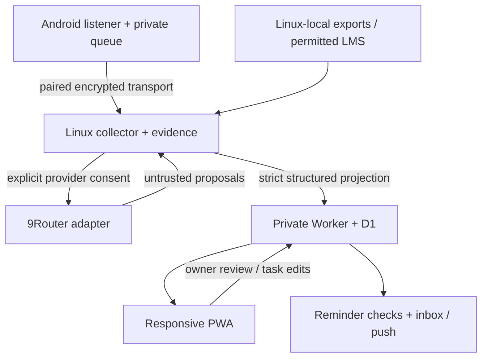

# 01 — Architecture and repository structure

Version 0.2.0. A single cloud application stores structured memory. Android observes selected notifications. Linux owns raw evidence, extraction and export import. Device networking does not make an offline laptop available.

## Proposed modules (M0 creates these; currently absent)

| Path | Responsibility | Forbidden dependency |
|---|---|---|
| `apps/web/src/features/{today,tasks,review,calendar,search,history,sources,settings}` | React TS static PWA, ID/EN and themes | No raw evidence fetch from cloud, router secret or collector key |
| `apps/web/src/lib/{api,offline,i18n,dates}` | Owner API, read cache, strings, timezone formatting | No universal raw payload cache |
| `apps/worker/src/{auth,routes,domain,db,scheduler,delivery}` | Owner/scoped collector APIs, D1 domain mutations, cron | No raw chat parser or 9Router callback |
| `apps/worker/migrations` | Versioned D1 SQL | No real data seeds |
| `apps/android-companion/app/src/main` | Kotlin permission/status/mapping/pairing/queue/transfer | No task-management screens, cloud raw endpoint or AI calls |
| `collectors/local/src/academic_os/{ingest,normalize,evidence,privacy,ai,sync,server}` | Python deterministic import + shared pipeline | No upstream account manipulation |
| `apps/local-ui` | Lightweight browser UI for import preview, consent and local evidence | Not exposed on public Internet; no background cloud loading of raw data |
| `packages/contracts` | Validation adapters/types from root schemas | No independently drifting schema copies |
| `tests/{fixtures,contract,integration,e2e}` | Synthetic multi-domain cases, negative tests | No real conversations/keys |
| `scripts` | Setup, checks, safe local backup/restore support | No paid provisioning side effects |

Prefer one React workspace with separate cloud/local entry builds if it avoids duplicate UI dependencies; distinct origins, capabilities and storage remain mandatory. M0 records exact bundling choice. Choose compatible maintained versions after checking Android 9 browser and low-resource build behavior. Python 3.11+ is a baseline, not a reason to replace the user's system Python.

## Trust and processing boundaries

1. OS callback only captures allowlisted WhatsApp events with trustworthy conversation mapping. Unmatched/private-conversation raw bodies are not persisted. Android handles eligible plaintext locally, encrypts durable payloads and disables cloud backup.
2. Phone→Linux uses an authenticated private remote link, app-level pairing and bounded immutable batches. No Worker, D1, R2, storage bucket or email relay for raw content. Metadata held by a VPN service is a separate disclosed processing boundary.
3. Linux commits receipt and evidence before acknowledgment. Raw exports are accepted only through local file selection; original phone exports may exist before user transfer, but Academic OS neither stores nor relays export archives on Android/cloud. Transfer directly to Linux without a cloud drive.
4. Extraction is deterministic/no-AI until the owner enables a named provider/route policy. 9Router may forward selected text externally; this is separate from cloud storage permission.
5. Projection converts local output into strict cloud task/proposal fields. No raw quote, arbitrary rationale or message body passthrough. Source references become random opaque IDs, not raw-content hashes.
6. Cloud owns task status and review decisions. Local collector can create proposals/assertions, never accept them. Android credential can write only its paired local endpoint, never cloud tasks.

## Mode matrix

| Mode | Capture | Processing | Task access / reminder checks |
|---|---|---|---|
| Phone + Linux + Internet | Listener best-effort, export on Linux | Local normalize/extract with consent | Cloud |
| Linux off | Phone queue best-effort | Waits, no new AI claim | Cloud continues |
| Private link down | Phone persists eligible queue | Linux can process exports already present | Cloud continues |
| 9Router off | Capture and normalization continue | AI pending, manual review possible | Cloud continues |
| Cloud down/quota exhausted | Local queues remain | Local work may proceed; sync pending | PWA snapshot, no cloud execution guarantee |
| Phone offline | Local capture if OS permits | No remote transfer | Cached read-only PWA |

## State and reconciliation

Capture event ID, normalized evidence ID, proposal ID, canonical task ID and sync batch ID are distinct. A repeated notification callback can be the same revision; changed payload is a new observation linked to prior event. Notification identity is not WhatsApp message identity. Conservative cross-source matches enrich references; uncertain matches become review flags.

Cloud mutations use bounded D1 atomic batches with optimistic checks. Candidate approval and task/event/reminder writes commit together. Do not perform network push inside a DB transaction. Claim lease first; dispatch separately; unknown outcomes remain unknown.

## Key ADRs

React TS/static PWA is recommended; Cloudflare Access with Worker-side verified identity is the preferred feasibility path. Python owns local normalization. Kotlin companion targets Android 9 compatibility. Tailscale is a candidate remote network; no account enrollment or vendor choice has been made. See [DECISIONS](DECISIONS.md) and [transport](15-PRIVATE-TRANSPORT.md).
